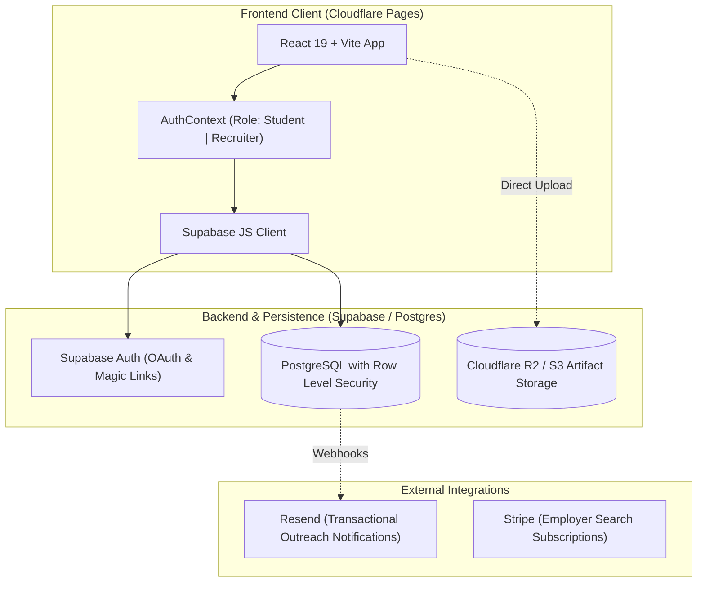

# Curiosity Passport — Commercial Multi-Tenant SaaS Architecture

This document describes the **60% Commercial SaaS Milestone** implemented on the `commercial-60` branch.

---

## 1. Architecture Overview



---

## 2. Relational Schema & Tables (`supabase/migrations/`)

The full PostgreSQL migration is located at:
[`supabase/migrations/20261116000000_init_commercial_schema.sql`](./supabase/migrations/20261116000000_init_commercial_schema.sql)

| Table | Description | Access Policy (RLS) |
| :--- | :--- | :--- |
| `profiles` | Extended user records (name, university, role, CQ score, XP). | Public read; self-write. |
| `curiosity_trails` | Published inquiry journeys, motivation, and synthesis insights. | Public read; author write/delete. |
| `trail_nodes` | Chronological research milestones (hypotheses, tests, evidence). | Public read; author write. |
| `tangible_artifacts` | Working prototypes, GitHub repos, models, and published papers. | Public read; author write. |
| `peer_reviews` | Cohort feedback, focus badges, and constructive commentary. | Public read; reviewer write. |
| `recruiter_outreach` | Employer outreach messages, role offers, and 4-stage pipeline. | Isolated strictly to recruiter and candidate. |
| `shortlists` | Bookmarked candidates for hiring teams. | Private to the recruiter. |
| `field_office_attendance` | Weekly meeting check-ins and dilemma decisions. | Private to the user. |

---

## 3. How to Connect Live Backend

1. Create a project at [supabase.com](https://supabase.com).
2. Copy your Project URL and Anon Public Key.
3. Create `.env` in this directory:
   ```env
   VITE_SUPABASE_URL=https://<your-project-id>.supabase.co
   VITE_SUPABASE_ANON_KEY=<your-anon-key>
   ```
4. Run the schema migration in the Supabase SQL Editor:
   Copy and execute `supabase/migrations/20261116000000_init_commercial_schema.sql`.
5. Run the dev server:
   ```bash
   npm run dev
   ```

---

## 4. The Remaining 40% Roadmap to 100% Commercial Production

| Component | Scope | Recommended Solution |
| :--- | :--- | :--- |
| **Live Email Webhooks** | Send actual email notifications to students when an employer reaches out. | Supabase Database Webhooks ➔ Resend API (`resend.emails.send()`). |
| **Direct Binary Artifact Storage** | Allow students to drag and drop PDFs, CAD drawings, and sensor logs. | Supabase Storage or Cloudflare R2 bucket with presigned URLs. |
| **Employer Search Subscriptions** | Paywall unlimited candidate messaging or advanced boolean search. | Stripe Checkout & Customer Portal (`@stripe/stripe-js`). |
| **University Cohort Dashboard** | Admin view for professors and career counselors to track student CQ scores. | Admin role flag in `profiles.role = 'admin'` with cohort reporting. |
